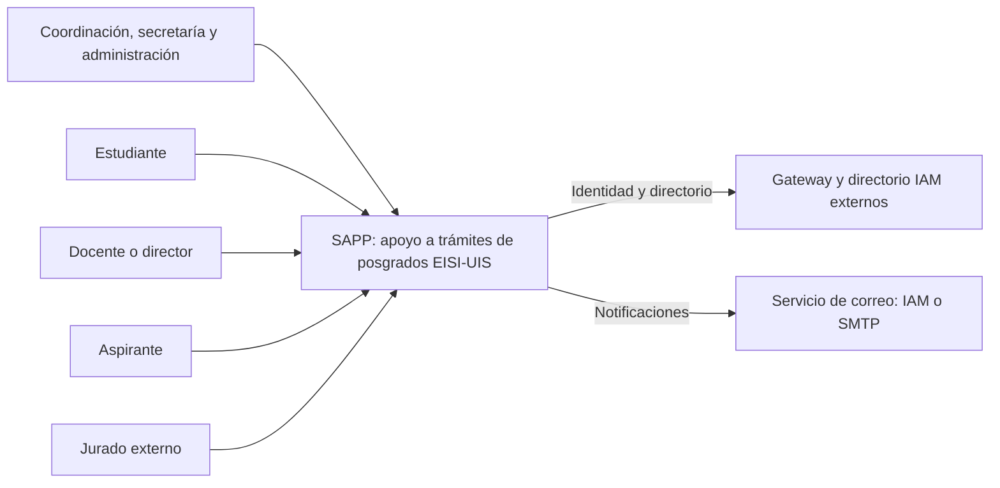
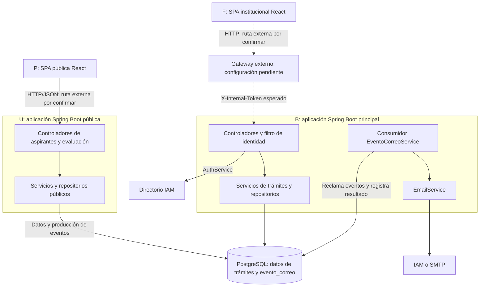
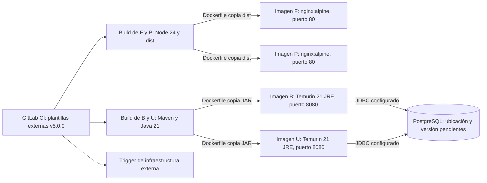
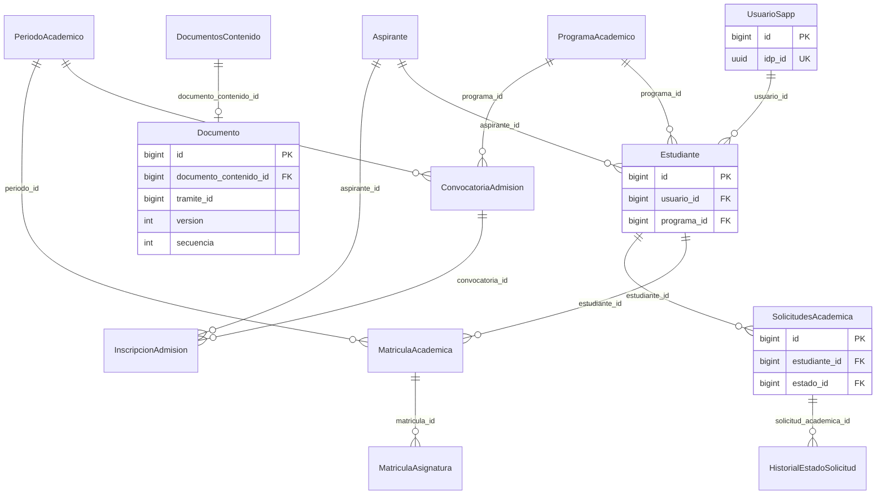

# Diagramas técnicos de SAPP

Revisión: 10 de octubre de 2026. Fuentes Mermaid editables y evidencia en [referencias.md](referencias.md). Las flechas discontinuas señalan infraestructura externa cuyo contrato se espera desde el código, pero cuya configuración no fue inspeccionada.

## Contexto del sistema

Fuente: [01-contexto.mmd](01-contexto.mmd). Evidencia: E01, E03, E04, E13, E14, E15.



## Componentes principales

Fuente: [02-componentes.mmd](02-componentes.mmd). Evidencia: E02–E05, E07, E13–E15.



## Despliegue declarado, sin inventar hosts

Fuente: [03-despliegue.mmd](03-despliegue.mmd). Evidencia: E16–E19.



## Entidades principales: relaciones del modelo actual

Fuente: [04-entidades.mmd](04-entidades.mmd). Evidencia: E08–E09, E11–E12.



## Resolución de sesión institucional

Fuente: [05-secuencia-inicio.mmd](05-secuencia-inicio.mmd). Evidencia: E02, E04.

```mermaid
sequenceDiagram
  actor U as Usuario institucional
  participant F as AuthProvider
  participant G as Gateway externo
  participant B as Filtro y AuthService
  participant I as Directorio IAM
  participant D as PostgreSQL
  Note over U,G: Autenticación previa y protocolo fuera de los cuatro proyectos
  U->>F: Abrir SPA
  F->>G: GET /api/sapp/inicio
  G->>B: GET /inicio y X-Internal-Token
  B->>B: Verificar firma y extraer sujeto
  alt Token ausente o inválido
    B-->>F: HTTP 401
  else Token verificado
    B->>I: Consultar usuario por UUID
    I-->>B: Identidad y roles
    B->>D: Buscar UsuarioSapp por idp_id y datos académicos
    D-->>B: Registro local
    B->>B: Exigir registro local y rol SAPP permitido
    B-->>F: UsuarioSAPPResponse o error
    F->>F: Guardar sesión y aplicar guards
  end
  Note over F,B: NO_TOKEN es marcador del cliente; no es una credencial JWT
```

## Registro y resolución de homologación

Fuente: [06-secuencia-homologacion.mmd](06-secuencia-homologacion.mmd). Evidencia: E09–E10, E13.

```mermaid
sequenceDiagram
  actor E as Estudiante
  participant F as SPA institucional
  participant B as SolicitudesAcademicaService
  participant D as PostgreSQL
  participant M as NotificacionSolicitudAcademicaService
  actor C as Gestión académica
  E->>F: Completar homologación
  F->>B: POST /solicitudesAcademicas
  B->>B: Validar tipo y asignaturas
  B->>D: Guardar solicitud ENVIADA, detalles e historial
  B->>M: Avisar solicitud pendiente de gestión
  B-->>F: StandardResponse con solicitud
  C->>F: Revisar y decidir
  F->>B: PUT /solicitudesAcademicas/cambioEstado/{id}
  Note over F,B: siglaEstado; actaId opcional; observaciones al rechazar
  alt APROBADA
    B->>D: Estado, fecha de resolución e historial de homologación
  else RECHAZADA
    B->>B: Exigir observaciones
    B->>D: Estado, fecha de resolución y motivoRechazo
  end
  B->>D: Registrar historial del cambio
  B-->>F: Resultado o error
  F->>B: GET /solicitudesAcademicas/{id}/historial
  B-->>F: Bitácora
  Note over F,D: Escrituras del servicio transaccionales; correo no es parte de la transacción de BD
  Note over F,B: Gateway omitido para legibilidad; no implica autorización uniforme por operación
```

## Lectura y límites

- Contexto: SAPP complementa sistemas institucionales; no se dibuja recaudo o sincronización no comprobados.
- Componentes: PostgreSQL representa las tablas compartidas observadas; no certifica una única instancia física ni acceso con el mismo usuario de base.
- Despliegue: cajas de imágenes/artefactos, sin asignarlas a hosts. Dockerfiles y CI no acreditan contenedores actualmente en ejecución, TLS, réplicas o disponibilidad.
- Entidades: subconjunto del modelo, no inventario exhaustivo. UsuarioSapp incorpora idp_id; no se incluye la tabla histórica personas_idp. Estudiante tiene unicidad compuesta usuario/programa en la migración actual. tramite_id de Documento se conserva como campo genérico, sin inventar FK a todos los trámites. DocumentosContenido–Documento refleja @OneToOne; la restricción física efectiva debe corroborarse en el esquema aplicado.
- Inicio: describe resolución de una identidad previamente autenticada, no las pantallas de contraseña del IAM.
- Homologación: la sigla almacenada es ENVIADA; la constante Java se llama ENVIADA_COMITE. El acta no es obligatoria para toda aprobación en el servicio actual.

Se verificó la correspondencia entre bloques y fuentes .mmd. No se ejecutó un renderizador Mermaid; antes de exportar figuras finales conviene abrirlos en el visor elegido.
